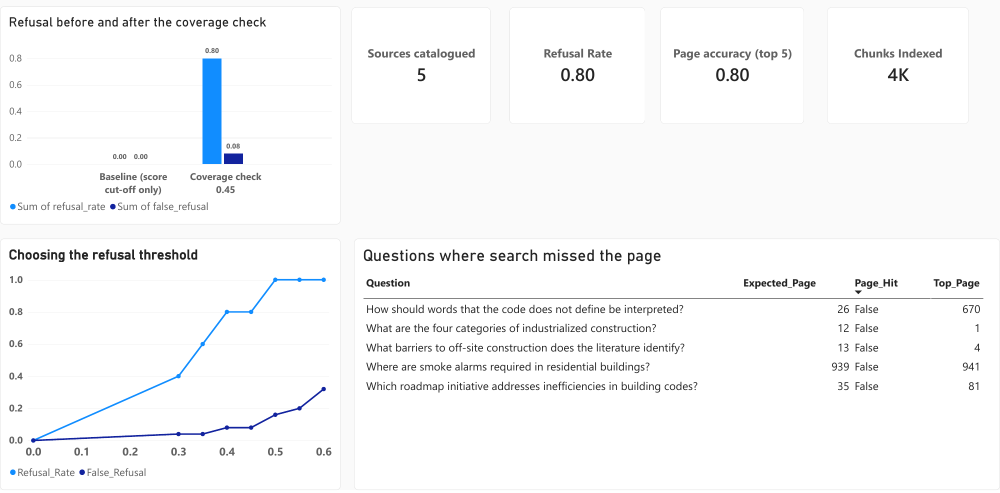
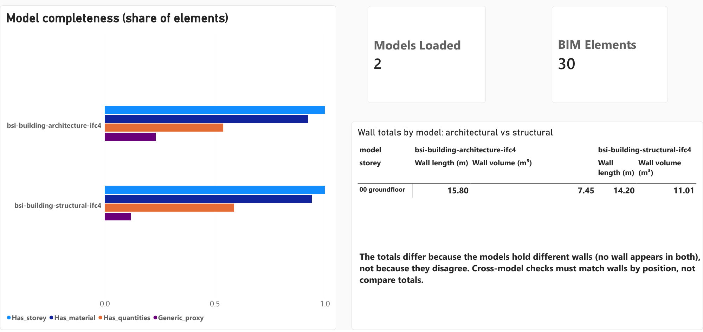

# Construction Knowledge Base

Governed search over Canadian construction documents: the National Building Code of Canada 2025, NRC's
industrialized-construction roadmap and related guides. Every answer cites document and page, and every
document is tracked in a source register with a checksum and an access level. A second module reads BIM
models (IFC) into the same DuckDB database.

**Why:** construction knowledge lives in long, unstructured PDFs and BIM models, not tables. This project
shows the information-management side of the problem: knowing what you hold, where it came from, whether
it changed, who may see it, and how well the search actually works.

## What it does

| Step | What happens | Governance point |
|---|---|---|
| Register | `sources/register.csv` lists each document: issuer, type, edition, published date, source URL, licence, access level | Required fields are validated; bad rows are marked `invalid` |
| Fingerprint | SHA-256 of every PDF on each build | A replaced file is flagged `changed` and re-ingested; unchanged files are skipped |
| Ingest | Text extracted page by page, split on paragraph boundaries, never across pages | Each chunk keeps its page and the nearest code article (e.g. `9.10.14.5`) |
| Search | BM25 keyword ranking, filtered by access level | `internal` documents are hidden unless explicitly requested |
| Answer | Top passages with `[doc p.N, section]` citations, or "Not found" when no passage covers enough of the question | Optional LLM hook only sees retrieved passages; uncited model answers are discarded |
| Evaluate | Hand-checked question set → hit@1, hit@5, page hit@5, MRR, refusal rate | Search quality is measured, not assumed |
| IFC | IfcOpenShell reads walls, slabs, etc. with storey, type, material and quantities | Same database, so documents and model data sit side by side |
| Export | `exports/*.csv` (catalog health, coverage, eval results, IFC summary) | Ready for a Power BI report |

## Quick start

```bash
pip install -r requirements.txt
pytest -q                      # 15 tests on generated PDFs and a generated IFC model

# 1. Download the PDFs listed in sources/register.csv into data/raw/ (names must match local_file)
# 2. Fill any blank required fields (the build tells you which)
PYTHONPATH=src python -m ckb build
PYTHONPATH=src python -m ckb ask "What does industrialized construction mean?"
PYTHONPATH=src python -m ckb eval                       # after writing eval/questions.csv
PYTHONPATH=src python -m ckb ifc data/raw/bsi-building-architecture-ifc4.ifc
PYTHONPATH=src python -m ckb ifc data/raw/bsi-building-structural-ifc4.ifc
```

Sample IFC models: [buildingSMART Sample-Test-Files](https://github.com/buildingSMART/Sample-Test-Files),
[IfcOpenShell test files](https://github.com/IfcOpenShell/files).

IFC models used: `Building-Architecture.ifc` and `Building-Structural.ifc` (IFC4) from buildingSMART
International's Sample-Test-Files, (c) buildingSMART International Ltd., licensed under
[CC BY 4.0](http://creativecommons.org/licenses/by/4.0/). Download them into `data/raw/` with the names
in `sources/register.csv`.

Source PDFs and models are **not committed** (see `.gitignore`); the register records where to get each one.

## Layout

```
sources/register.csv     source register (hand-maintained)
eval/questions.csv       hand-checked question set
src/ckb/catalog.py       register validation + SHA-256 change detection
src/ckb/ingest.py        PDF text extraction and page-aware chunking
src/ckb/search.py        BM25 ranking with access-level filter
src/ckb/answer.py        cited answers, refusal, LLM guardrail
src/ckb/evaluate.py      retrieval metrics
src/ckb/ifc_extract.py   IFC elements, placements and quantities -> DuckDB (SI units, quality view)
src/ckb/pipeline.py      build + CSV exports
tests/                   pytest suite (runs in GitHub Actions)
```

## Results

Corpus: NBC 2025 (1,693 pages), NRC/UNB industrialized construction roadmap (97 pages) and its 2-page summary,
about 4,170 chunks. Question set: 30 hand-checked questions in `eval/questions.csv` (25 answerable, 5 not
covered by the documents), each with the page and the line that answers it.

| Version | hit@1 | Page hit@5 | MRR | Refusal (should refuse) | False refusal (should answer) |
|---|---|---|---|---|---|
| Baseline: BM25 + score cut-off | 0.88 | 0.80 | 0.93 | 0.00 | 0.00 |
| + coverage check (threshold 0.45) | 0.88 | 0.80 | 0.93 | **0.80** | 0.08 |

### Refusal threshold

BM25 scores are not comparable across questions, so a score cut-off never refused anything: a question
about Toronto zoning still returned building-code passages. The coverage check asks whether any retrieved
passage contains most of the question's informative words, weighted by rarity; words the corpus never uses
count as fully missing.

| Threshold | Refusal | False refusal |
|---|---|---|
| 0.30 | 0.40 | 0.04 |
| 0.40 | 0.60 | 0.08 |
| **0.45** | **0.80** | **0.08** |
| 0.50 | 1.00 | 0.16 |
| 0.60 | 1.00 | 0.32 |

0.45 was chosen as a round value in the gap between the two groups, not the single best point. It was
tuned on the same 30 questions, so it should be confirmed on new questions before relying on it.

Remaining errors: the two false refusals are paraphrases ("climb or descend" vs the code's "travel up or
down"; "words the code does not define" vs "undefined terms"), and one cost question still slips through.
Of the five page misses, three land on summary or appendix pages that repeat the question's words, one is
a paraphrase and one is two pages off. Meaning-based (embedding) search and down-weighting summary pages are
the next steps. Full write-up: [docs/REPORT.md](docs/REPORT.md).

## Power BI report

`docs/ckb-report.pbix` (built from `exports/ckb_powerbi.xlsx`, regenerated with `python -m ckb powerbi`):

- **Page 1, Governance and search quality:** sources catalogued, chunks indexed, page accuracy, refusal before
  and after the coverage check, the threshold trade-off, and the questions where search missed the page.
- **Page 2, BIM model quality:** completeness by model and the architectural vs structural wall totals.





## BIM model results

Two discipline models of the same sample house (architectural and structural) were loaded with IfcOpenShell.

**Units.** Both models store lengths in millimetres but areas and volumes in m2/m3. Every quantity is
converted to SI using the model's declared units before it is stored, so totals can be compared and summed.
Each summary column also uses one measure only (e.g. wall run length, not slab thickness; surface area, not
beam cross-section), so different measures are never added together.

**Model completeness** (`exports/ifc_quality.csv`):

| Model | Elements | With storey | With material | With quantities | Generic proxies |
|---|---|---|---|---|---|
| Architectural | 13 | 100% | 92% | 54% | 23% |
| Structural | 17 | 100% | 94% | 59% | 12% |

**Cross-model check.** Compared by class, the two models seem to disagree about the ground-floor walls:
15.8 m and 7.45 m3 (architectural) vs 14.2 m and 11.0 m3 (structural). Checking each wall's placement shows
that comparison is wrong: **no wall appears in both models.** The architectural model holds the walls running
one direction plus a 24 mm gypsum plumbing partition; the structural model holds the walls running the other
direction plus a 200 mm load-bearing inner wall. The models are complementary, so the house's walls total
30.0 m and 18.5 m3 across both. Cross-discipline checks need to match elements by location or ID, not by
class totals, or they report discrepancies that do not exist.

| Model | Wall | Position (m) | Direction | Length (m) | Width (m) | Volume (m3) |
|---|---|---|---|---|---|---|
| Architectural | outer, left | (3.1, 3.0) | y | 6.0 | 0.200 | 4.23 |
| Architectural | outer, right back | (8.5, 9.0) | y | 4.2 | 0.200 | 1.79 |
| Architectural | outer, right front | (7.1, 4.8) | y | 1.8 | 0.200 | 1.27 |
| Architectural | plumbing partition | (8.4, 8.8) | y | 3.8 | 0.024 | 0.16 |
| Structural | outer, front | (3.0, 3.0) | x | 3.8 | 0.200 | 2.93 |
| Structural | outer, back | (3.2, 8.9) | x | 5.2 | 0.200 | 4.29 |
| Structural | outer, front right | (8.4, 4.9) | x | 1.3 | 0.200 | 0.75 |
| Structural | inner, load-bearing | (7.1, 4.9) | x | 3.9 | 0.200 | 3.04 |

## Limitations

- Keyword search: misses questions phrased very differently from the code text. Embedding search is the natural next step, and the eval set shows whether it helps.
- Tables and figures in the PDFs extract poorly; answers about values in tables should be checked against the page cited.
- The register's access levels demonstrate the control; they are not a security boundary.
