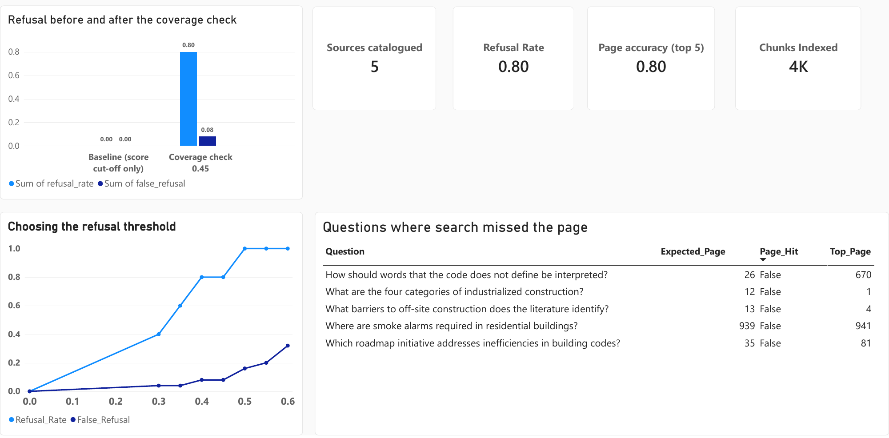
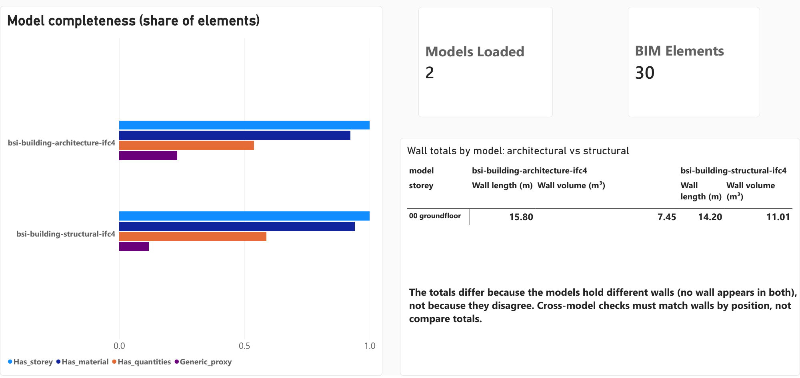

# Construction Knowledge Base: Technical Report

**Author:** Tanima Garg · **Date:** November 2026 · **Code:** [github.com/tanima-pr/construction-knowledge-base](https://github.com/tanima-pr/construction-knowledge-base)

## 1. Problem

Much of what the construction sector knows sits in long PDF documents (codes, guides, research reports)
and in BIM models, not in tables. NRC's industrialized construction roadmap (April 2025), prepared for the
Construction Research Centre's Construction Sector Digitalization and Productivity program, lists capturing
data and measuring impact among its focus areas and calls for a national construction productivity data
framework. Before that kind of information can support analysis, someone has to know what documents and
models are held, where they came from, whether they changed, who may see them, and how reliably they can be
searched.

This project builds a small, governed version of that: a search tool over two core construction documents
and a loader for BIM models, with every step recorded and its quality measured.

## 2. Data and governance

| Source | Type | Pages / elements | Licence |
|---|---|---|---|
| National Building Code of Canada 2025 (16th ed.) | code | 1,693 pages | (c) NRC 2025, all rights reserved |
| Roadmap to Transform the Canadian Construction Industry through IC | report | 97 pages | (c) 2025 NRC, UNB, UofA, Cast Consultancy, all rights reserved |
| Roadmap summary | summary | 2 pages | no licence stated, treated as all rights reserved |
| buildingSMART sample house, architectural model | IFC4 | 13 elements | (c) buildingSMART International, CC BY 4.0 |
| buildingSMART sample house, structural model | IFC4 | 17 elements | (c) buildingSMART International, CC BY 4.0 |

Every source is a row in a hand-maintained **source register** (`sources/register.csv`): issuer, type,
edition, publication date, source URL, licence and access level (`public` or `internal`). Each build:

- validates the register (missing required fields, invalid access levels and duplicate IDs mark a row `invalid`);
- computes a **SHA-256 fingerprint** of each file, flags a replaced file as `changed` and re-ingests only that file;
- keeps documents marked `internal` out of search results unless explicitly requested.

Copyright terms were read from each file and recorded in the register. Because the PDFs are all rights
reserved, they are not redistributed in the repository; the register says where to obtain each one.

## 3. Method

**Text extraction and cleaning.** Text is extracted page by page. Two problems appeared on the real documents:

- The NBC prints a bilingual copyright line on every page. Left in, it would sit in every chunk and match
  any query mentioning "Canada" or "National Research Council". Lines repeated on at least 20% of pages
  (with page numbers normalised) are removed as running headers and footers.
- Table-of-contents lines ("2.2.1 Productivity ........ 15") ranked highly for many questions while
  containing no content. Lines with dot leaders are dropped, as are fragments under 25 letters or digits.

19 NBC pages and 22 roadmap pages have no extractable text (mostly figures).

**Chunking.** Each page is split on paragraph boundaries into chunks of about 900 characters. Chunks never
cross a page, so every result cites exactly one page. The nearest code article heading (e.g. `9.8.4.1
Dimensions for Risers`) is carried with each chunk. This produced 4,174 chunks; 1,758 distinct NBC sections
were detected.

**Search.** BM25 keyword ranking over chunk text, section heading and document title.

**Answering and refusal.** Answers are the top passages with `[document p.N, section]` citations. BM25 scores
are not comparable across questions, so a score cut-off cannot tell a weak match from no match. A
**coverage check** asks whether any retrieved passage contains enough of the question's informative words,
weighted by how rare each word is in the corpus; words the corpus never uses count as fully missing. Below
a coverage of 0.45 the tool answers "Not found in the indexed documents." An optional language-model step
only sees retrieved passages, and any model answer without a citation is discarded.

## 4. Evaluation

**Question set.** 30 questions written against the documents and checked page by page (`eval/questions.csv`):
10 on the NBC, 9 on the roadmap, 3 on the summary, 3 that require choosing the right document among similar
ones, and 5 that the documents do not answer (e.g. local zoning, wages, costs). Each answerable question
records the page where the answer appears.

**Results.**

| Version | Right document first | Right document, top 5 | Right page, top 5 | MRR | Correct refusal | False refusal |
|---|---|---|---|---|---|---|
| Score cut-off only (baseline) | 88% | 100% | 80% | 0.93 | 0% | 0% |
| + coverage check at 0.45 | 88% | 100% | 80% | 0.93 | **80%** | 8% |

Document-level accuracy is inflated by the small number of documents; **right page in the top 5** is the
meaningful retrieval measure.

**Choosing the threshold.**

| Coverage threshold | Correct refusal | False refusal |
|---|---|---|
| 0.30 | 40% | 4% |
| 0.40 | 60% | 8% |
| **0.45** | **80%** | **8%** |
| 0.50 | 100% | 16% |
| 0.60 | 100% | 32% |

0.45 is a round value in the gap between the two groups of questions, not the single best point.

*Figure 1. Power BI report, page 1 (built from `exports/ckb_powerbi.xlsx`).*

**Where it fails.**

- *Page misses (5 of 25):* three land on a page that repeats the question's words without answering it (the
  roadmap's executive summary, the two-page summary, and an interview-guide appendix); one is a paraphrase the
  keywords cannot bridge ("words the code does not define" vs the code's "undefined terms"); one lands two
  pages away (smoke alarms: p.941 instead of p.939).
- *False refusals (2 of 25):* both paraphrases ("climb or descend" vs the code's "travel up or down").
- *Missed refusal (1 of 5):* a cost-per-square-foot question shares enough words with the roadmap to pass.

## 5. BIM models

Two discipline models of the same buildingSMART sample house were loaded with IfcOpenShell.

**Units.** Both models store lengths in millimetres but areas and volumes in m² and m³. All quantities are
converted to SI using each model's declared units before storage. Summary columns each use one measure
(wall run length, not slab thickness; surface area, not beam cross-section), so different measures are never
added together.

**Completeness.**

| Model | Elements | With storey | With material | With quantities | Generic proxies |
|---|---|---|---|---|---|
| Architectural | 13 | 100% | 92% | 54% | 23% |
| Structural | 17 | 100% | 94% | 59% | 12% |

*Figure 2. Power BI report, page 2: model completeness (share of elements with a storey, a material and
quantities, and the share that are generic proxies) and wall totals by model.*

**Cross-model check.** Compared by class, the models appear to disagree on the ground-floor walls
(15.8 m and 7.45 m³ architectural vs 14.2 m and 11.0 m³ structural), which reads as a 48% volume discrepancy.
Comparing each wall's placement shows that **no wall appears in both models**: the architectural model holds
the walls running one direction plus a 24 mm gypsum plumbing partition, and the structural model holds the
walls running the other direction plus a 200 mm load-bearing inner wall. The models are complementary, and
the house's walls total 30.0 m and 18.5 m³ across both.

The lesson for cross-discipline quality checks is that elements must be matched by location or identifier,
not by class totals; otherwise the check reports discrepancies that do not exist.

## 6. Limitations

- **Keyword search.** Paraphrased questions miss (one page miss and both false refusals), and pages that
  repeat a question's words, such as summaries and appendices, can outrank the page that answers it.
- **Threshold tuned on the evaluation set.** The 0.45 threshold was chosen using the same 30 questions it is
  reported on. It should be confirmed on new questions before being relied on.
- **Small corpus and question set.** Three documents and 30 questions show the method; they do not
  establish performance on a larger collection.
- **Tables and figures.** Values inside PDF tables extract with broken spacing, and figure-only pages carry no
  text. Answers about tabulated values should be checked against the cited page.
- **Access levels demonstrate the control; they are not a security boundary.**
- **Sample BIM models.** The IFC files are small teaching models, not project models.

## 7. Next steps

1. Add meaning-based (embedding) search alongside BM25 and measure whether it recovers the paraphrase misses
   without raising false refusals; down-weight summary and appendix pages when a full section also matches.
2. Write a second, separate set of questions to confirm the refusal threshold.
3. Add CMHC research on modular and offsite construction, and a later NBC edition alongside 2025, to test
   edition tracking.
4. Match BIM elements across models by location so genuine clashes and duplicates can be reported.
